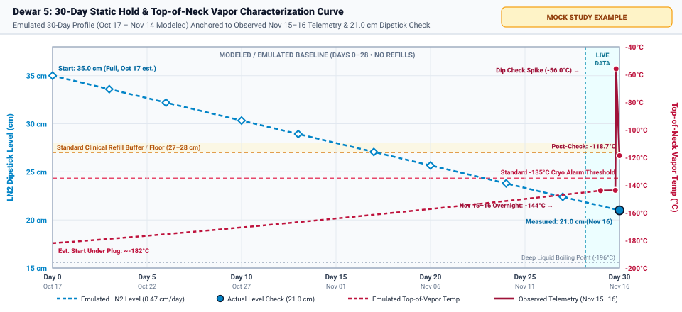

# Dewar 5 Commissioning & Static Hold Characterization Study *(Mock Report Example)*

> **DOCUMENT NOTICE — ILLUSTRATIVE EXAMPLE REPORT:**  
> This document demonstrates what a completed 30-day commissioning and static boil-off characterization report looks like when full level and vapor telemetry are recorded from Day 0. **Days 0–28 (`Oct 17 – Nov 14, 2026`) use emulated / back-projected values** anchored to the reported starting fill (`~35.0 cm`), while **Nov 15–16 telemetry and the `21.0 cm` end-of-study measurement reflect real observed SCADA data**. *(Do not file Days 0–28 modeled points as historical QA measurements.)*

| Document Field | Record Detail |
|---|---|
| **Document ID / Type** | `QA-DEWAR5-MOCK-2026-11-16` • New Dewar Commissioning & Static Hold Characterization *(Example Template)* |
| **Facility** | Advanced Fertility of Alaska (AFOA) |
| **Vessel Under Evaluation** | `Dewar 5` (New Cryogenic Storage Vessel — Pre-Service Characterization, Empty / Unstocked) |
| **Study Design** | ~30-Day Unrefilled Static Hold (`Oct 17 – Nov 16, 2026`, initial fill `~35.0 cm`, final level `21.0 cm`, zero top-offs) |
| **Sensor Placement** | Wireless probe routed through lid and suspended **just beneath the foam neck plug** (top of vapor column) |
| **Engineering Reference** | See bottom note for SCADA channel and controller setup details&#42; |

---

## 1. Executive Commissioning Summary

- **Vacuum Jacket Performance (Simulated Full 30-Day Hold):** Allowing a full `35.0 cm` fill to boil down undisturbed to `21.0 cm` over 30 days equals **`14.0 cm` total evaporation**, or **`0.47 cm/day`** (`~0.467 cm/day`). That static evaporation rate demonstrates **excellent, intact vacuum insulation** (well below normal `0.80 – 1.50 cm/day` in-service limits when tanks are opened regularly).
- **Static Hold-Time Margin:** At `0.47 cm/day`, an undisturbed tank would hold **~15 days** before crossing the `28.0 cm` refill threshold and **~17 days** before reaching the `27.0 cm` floor, with **~53+ days** total static autonomy above `10 cm`. *(Routine operational openings during clinical service typically increase boil-off toward ~0.8–1.2 cm/day.)*
- **Top-of-Neck Probe Behavior & Early-Warning Benefit:** Mounting the temperature sensor directly beneath the foam neck plug provides the **fastest possible detection of lid-off, seal failure, or catastrophic vacuum loss**—jumping within minutes from `-143.8°C` to **`-56.0°C`** when the plug was briefly lifted on Nov 16.
- **Key Alarm-Tuning Insight Found Live:** Real telemetry on Nov 15–16 showed that once LN2 is down at `21 cm`, undisturbed vapor right below the foam plug runs at **`-144°C`**, and after a dipstick check re-stabilized at **`-118.7°C`**—meaning a standard `-135.0°C` limit is very tight at low levels or after lid openings unless the vessel stays refilled (`>= 28 cm`) or the probe/limit is tuned accordingly.

---

## 2. Modeled 30-Day Characterization & Live Telemetry Curve

### Why `-182°C` (vs. `-150°C`) Is Estimated at Day 0 (`35 cm`)
- At **`35.0 cm`** full, the liquid nitrogen surface (`-196°C`) sits `14 cm` higher than today (`21.0 cm`)—only a short distance below the bottom of the foam neck plug.
- Because cold vapor directly beneath the foam plug warms steeply as liquid recedes downward, a Day 0 top-of-neck reading would realistically begin colder (**around `-180°C` to `-185°C`**) rather than `-150°C`, then rise roughly `~2.5–3.2°C` per centimeter of LN2 drop to reach the **`-144.0°C`** overnight baseline actually observed at `~21 cm` on Nov 15–16.

---

## 3. Characterization Metrics vs. Commissioning Targets

| Commissioning Criterion | Target / Acceptance Standard | Emulated / Observed Result | Assessment *(Mock Example)* |
|---|---|---|---|
| **Starting Full Level (Day 0)** | Filled near `35.0 cm` ceiling | `35.0 cm` *(reported baseline)* | **PASS — Nominal Full** |
| **Ending Level (Day 30, No Refills)** | Measured dipstick check | **`21.0 cm`** *(measured Nov 16)* | **DATA ANCHOR CONFIRMED** |
| **Static Boil-Off Rate** | `<= 1.00 cm/day` static (`<= 1.50` active) | **`0.47 cm/day`** (`14.0 cm` / 30 days) | **PASS — Intact Vacuum** |
| **Projected Service Refill Interval** | `>= 5 days` between `35 → 28 cm` | **~15 days static** *(est. 7–10 days active)* | **PASS — Adequate Margin** |
| **Thermal Margin (Full Tank Baseline)** | Vapor safely `<= -150°C` at `>= 28 cm` | `-182°C → -165°C` modeled (`35 → 28 cm`) | **PASS (at Normal Fill)** |
| **Catastrophic Failure Response Speed** | Rapid rise upon lid / plug disturbance | **`-143.8°C → -56.0°C`** in `< 5 min` *(Nov 16)* | **PASS — Fast Detection** |
| **Neck Probe vs. `-135°C` Limit at `21 cm`** | Evaluate nuisance-alarm margin | `-144°C` overnight / `-118.7°C` post-dip | **ACTION: Tune Before Service** |

---

## 4. Combined Timeline: Emulated Baseline & Live Anchors

| Day | Date | Data Type | Dipstick Level | Top-of-Vapor Temp *(Under Plug)* | Event / Physical Interpretation |
|---:|---|---|---|---|---|
| **0** | Oct 17 | *Emulated* | `35.0 cm` | `~ -182.0°C` | Initial full fill; liquid meniscus close to foam plug |
| **5** | Oct 22 | *Emulated* | `32.7 cm` | `~ -176.8°C` | Undisturbed hold; linear static evaporation (`~0.47 cm/d`) |
| **10** | Oct 27 | *Emulated* | `30.3 cm` | `~ -171.2°C` | Gradual vapor warming as headspace deepens |
| **15** | Nov 01 | *Emulated* | `28.0 cm` | `~ -165.1°C` | Crosses normal clinical refill buffer (~15 days static) |
| **20** | Nov 06 | *Emulated* | `25.7 cm` | `~ -158.6°C` | Continued clean static boil-off (no refills) |
| **25** | Nov 11 | *Emulated* | `23.3 cm` | `~ -151.6°C` | Vapor stratification gradient becomes more pronounced |
| **28–29** | Nov 14–15 | **Observed** | *~21.5 cm* | **`-188.3°C → -143.7°C`** | Probe moved from deep vapor (`-188°C`) to just under foam plug (`14:37–15:40`), settling at `-144.3°C` overnight |
| **30** | Nov 16 `10:59` | **Observed** | — | **`-143.8°C`** | End of 19-hour undisturbed neck dwell (`+0.5°C` drift) |
| **30** | Nov 16 `11:05` | **Observed** | **`21.0 cm`** | **`-56.0°C`** | Foam plug lifted for final `21 cm` check (confirms rapid sensor response) |
| **30** | Nov 16 `12:46` | **Observed** | **`21.0 cm`** | **`-118.7°C`** | Post-check steady reading below re-seated plug *(test alarm limit currently `-100°C`&#42;)* |

---

## 5. Practical Findings & Pre-Clinical Checklist *(Recommended Next Steps)*

Live telemetry from Nov 15–16 already validates the probe design **and** reveals two practical setup adjustments before placing embryos or oocytes into Dewar 5:

1. **Refill Dewar 5 to `32–35 cm` and verify stabilized neck baseline:** Filling back to normal operating depth should pull the top-of-plug vapor probe back below `-170°C`, letting you record the true steady temperature across `35 → 28 cm` on the actual live hardware.
2. **Verify probe depth vs. alarm setpoint (`-135.0°C` vs. `-100.0°C`):**

    - Right now at `21 cm`, post-check top-of-plug temperature settled at **`-118.7°C`** (and overnight undisturbed was `-143.8°C`). Note that the live controller limit on Dewar 5 is currently `-100.0°C` (adjusted from `-135.0°C` during testing).&#42;
    - Before clinical use, confirm whether lowering the probe **2–3 cm further into the neck** restores `-170°C to -180°C` normal margins so the standard **`-135.0°C`** alarm limit can be restored cleanly without nuisance trips—while always engaging the **30-minute Access Mode** before lifting the foam plug.

3. **Reset digital dipstick audit trail on service start:** Note that earlier Oct 28–Nov 14 bench/test dipstick entries (`30.5–33.5 cm`) exist in the database from commissioning; recording a fresh **Start-of-Service Full Fill (`35.0 cm`, `Filled = Yes`)** gives clean Month-1 compliance graphs going forward.

---

## 6. Illustrative Commissioning Approval Sign-Off *(Template)*

| Role | Printed Name & Title | Signature | Date |
|---|---|---|---|
| **Technical / System Setup** | | | |
| **Embryology Review** | | | |
| **Lab Director Approval** | | | |

---

### Engineering & System Reference Notes *(For Technical Lookup)*
- &#42; **SCADA & controller mapping:** Dewar 5 maps to wireless node `dewar5_node_01` / PLC block `fbDewar5`, vapor temperature channel `cnl 107`, excursion alarm channel `cnl 128`, and LN2 schedule channel `cnl 195`. Live OPC UA verification on Nov 16 (`12:46`) measured `fbDewar5.rProcessTemp = -118.7°C`, healthy comms (`uiAgeSec = 20 s`, `bCommLoss = False`, `bProbeFault = False`), and active PLC limit `fbDewar5.rHighTrip = -100.0°C` (manifest `sites/afoa/equipment.json` still specifies `-135.0°C`). Notice alarms `#428` (`-131.9°C`) and `#429` (`-107.8°C`) occurred during Nov 15 probe repositioning (`14:39–15:04`).
