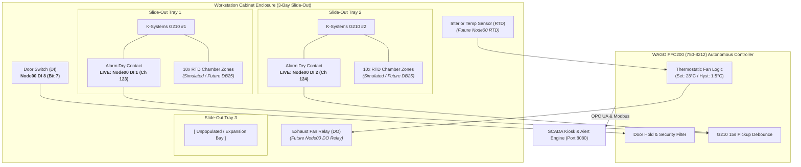

# IVF Incubator Subsystem Architecture & Integration Roadmap

## 1. Executive Summary & Clarified Hierarchy

The physical setup in the embryology lab separates the **climate-controlled enclosure** from the **incubation instruments** themselves:

```
[ Incubator Cabinet 01 (Enclosure) ]
  ├── Cabinet Door Switch (DI 8 / Bit 7) - Slide-out access monitoring
  ├── Cabinet Interior Temperature Sensor (RTD) - Measures trapped waste heat
  ├── Cabinet Exhaust Fan Relay (DO) - Autonomous thermostatic cooling by WAGO 750-8212
  └── Slide-out Trays (Capacity: 3 Bays)
        ├── Tray 1: K-Systems G210 #1 (Alarm Dry Contact + 10 RTD outputs)
        ├── Tray 2: K-Systems G210 #2 (Alarm Dry Contact + 10 RTD outputs)
        └── Tray 3: [ Empty / Unpopulated Expansion Bay ]

[ Standalone Box Incubators ]
  └── Astec SCA-165DRS #1 (Chamber Alarm Dry Contact + External RTD Probe)
```

### The Role of the Incubator Cabinet & PLC-8212 Autonomous Control
* The **Incubator Cabinet** is NOT an incubator. It is a specialized furniture enclosure with slide-out trays holding benchtop equipment.
* Because K-Systems incubators radiate ambient waste heat, a closed cabinet will heat up over time.
* The **WAGO PFC200 (750-8212)** PLC will execute an autonomous local thermostatic control loop via `FB_IncubatorCabinet`:
  - Continuously monitors the internal cabinet RTD.
  - When internal temperature exceeds setpoint (e.g., $> 28.0^\circ\text{C}$), energizes the Fan Relay DO.
  - Implements a hysteresis deadband (e.g., turns off when cooled below $26.5^\circ\text{C}$) to prevent rapid cycling.
  - Monitors the **Cabinet Door Switch (DI 8)**: suppresses nuisance alarms during tray slide-out and provides a 3-minute post-closure recovery grace timer (`TOF`).

---

## 2. Updated System Topology & Control Loop



---

## 3. Declarative Schema (`equipment.json`)

Here is how the hierarchy is modeled cleanly without breaking any existing channel polling:

```json
{
  "cabinets": [
    {
      "id": 1,
      "key": "cab_benchtop_01",
      "name": "Workstation Enclosure 01",
      "label": "Benchtop Incubator Cabinet",
      "desc": "3-Bay Slide-Out Enclosure with Thermostatic Exhaust Fan",
      "capacity_bays": 3,
      "door_cnl": null,
      "temp_cnl": null,
      "fan_command_cnl": null,
      "fan_setpoint": 28.0,
      "fan_hysteresis": 1.5,
      "target_temp_label": "Cabinet Limit: < 28.0°C",
      "incubator_keys": ["inc1", "inc2"]
    }
  ],
  "incubators": [
    {
      "id": 1,
      "key": "inc1",
      "parent_cabinet": "cab_benchtop_01",
      "bay_number": 1,
      "name": "Incubator 01",
      "model": "K-Systems G210",
      "subtitle": "Bay 1 • G210 InviCell",
      "plc_fb": "fbIncubator1",
      "alarm_cnl": 123,
      "has_zone_temps": true,
      "zone_count": 10,
      "zone_simulated": true,
      "target_temp": 37.0
    },
    {
      "id": 2,
      "key": "inc2",
      "parent_cabinet": "cab_benchtop_01",
      "bay_number": 2,
      "name": "Incubator 02",
      "model": "K-Systems G210",
      "subtitle": "Bay 2 • G210 InviCell",
      "plc_fb": "fbIncubator2",
      "alarm_cnl": 124,
      "has_zone_temps": true,
      "zone_count": 10,
      "zone_simulated": true,
      "target_temp": 37.0
    },
    {
      "id": 3,
      "key": "box_inc1",
      "parent_cabinet": null,
      "bay_number": null,
      "name": "Box Incubator 01",
      "model": "Astec SCA-165DRS",
      "subtitle": "Standalone Box Chamber",
      "plc_fb": "fbBoxIncubator1",
      "alarm_cnl": null,
      "temp_cnl": null,
      "has_zone_temps": false,
      "target_temp": 37.0,
      "is_commissioning": true
    }
  ]
}
```

---

## 4. CODESYS PFC200 (750-8212) Autonomous Thermostat Function Block

In CODESYS, we encapsulate the cabinet's autonomous cooling and door supervision in `FB_IncubatorCabinet.st`:

```structuredtext
FUNCTION_BLOCK FB_IncubatorCabinet
VAR_INPUT
    rCabinetTemp        : REAL := 24.0;    (* From 750-461 RTD slice *)
    bDoorSwitch         : BOOL := FALSE;   (* TRUE = Open, FALSE = Closed *)
    rFanOnSetpoint      : REAL := 28.0;    (* Fan ON threshold in °C *)
    rFanHysteresis      : REAL := 1.5;     (* Deadband in °C (turns off at 26.5°C) *)
    tDoorOpenAlarmDelay : TIME := T#3M;    (* Door left open alarm delay *)
END_VAR
VAR_OUTPUT
    bFanCommand         : BOOL := FALSE;   (* Direct drive to 750-512 relay DO *)
    bCabinetOvertemp    : BOOL := FALSE;   (* Priority 2 alert to SCADA *)
    bDoorAlarm          : BOOL := FALSE;   (* Door left open alert *)
END_VAR
VAR
    tonDoorOpen         : TON;
END_VAR

// 1. THERMOSTATIC FAN CONTROL WITH HYSTERESIS
IF rCabinetTemp >= rFanOnSetpoint THEN
    bFanCommand := TRUE;
ELSIF rCabinetTemp <= (rFanOnSetpoint - rFanHysteresis) THEN
    bFanCommand := FALSE;
END_IF;

// 2. OVERTEMP ALARM (e.g. Fan failure or thermal runaway inside cabinet)
bCabinetOvertemp := (rCabinetTemp >= 32.0);

// 3. DOOR OPEN SUPERVISION
tonDoorOpen(IN := bDoorSwitch, PT := tDoorOpenAlarmDelay);
bDoorAlarm := tonDoorOpen.Q;
```

---

## 5. UI Layout on Dashboard Kiosk

### Card Structure:
1. **Workstation Cabinet Enclosure Card**:
   - Header with status bar:
     - 🚪 Door: `CLOSED`
     - 🌡️ Cabinet Temp: `24.5°C` *(Limit: < 28.0°C)*
     - 🌀 Fan: `OFF (Auto)`
   - Inner 3-Bay Grid:
     - **Bay 1 Tray**: `Incubator 01 (G210)` $\to$ `NORMAL` (Live DI 1) `[🔍 Inspect 10 Zones]`
     - **Bay 2 Tray**: `Incubator 02 (G210)` $\to$ `NORMAL` (Live DI 2) `[🔍 Inspect 10 Zones]`
     - **Bay 3 Tray**: `[ Slide-Out Tray 3: Empty / Spare ]` *(Dotted outline)*
2. **Box Incubator Card** (Standalone):
   - `Astec SCA-165DRS` $\to$ `STANDBY (Commissioning)`

Clicking Bay 1 or Bay 2 opens the modal drawer showing the 10 chamber heating zones in realistic simulation mode, while the alarm state reflects your live Modbus terminal.
