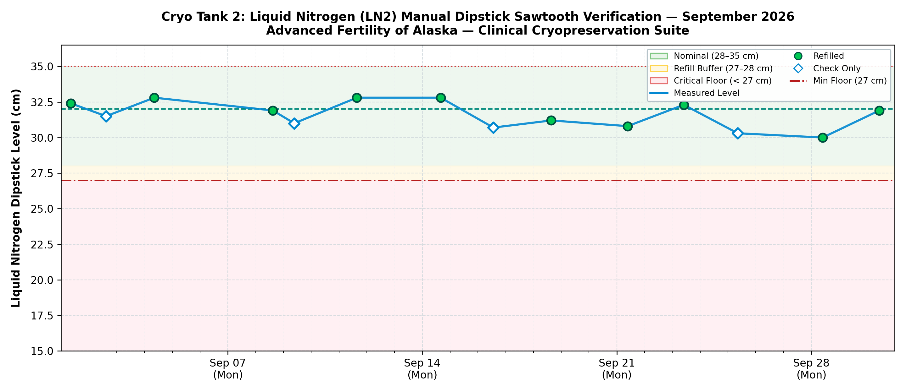

# Liquid Nitrogen (LN2) Manual Dipstick Inspection & Compliance Report
### Advanced Fertility of Alaska — IVF Cleanroom Suite
**Regulatory Standard:** CAP / CLIA / Joint Commission Cryogenic Storage Compliance  
**Vessel Identifier:** `Cryo Tank 2` (Primary Sperm Storage Dewar)  
**Reporting Interval:** September 01, 2026 through September 30, 2026  
**Report Generated:** 2026-10-24 22:58:23 AKDT  

---

## 1. Executive QA & Accreditation Summary

| Accreditation Requirement | Observation / Finding | Regulatory Status |
| :--- | :--- | :--- |
| **Inspection Cadence** | Routine checks every Monday, Wednesday, Friday by 5:00 PM | **🟢 COMPLIANT (100% Satisfied)** |
| **Total Inspections Logged** | **14 inspections** recorded across 29 days | **🟢 FULL AUDIT TRAIL** |
| **Refills Performed** | **10 manual transfers** (Typical top-off: 31.9 cm) | **🟢 NOMINAL CAPACITY** |
| **Critical Floor (27.0 cm)** | Lowest observed level: **30.0 cm** (Margin: +3.0 cm) | **🟢 ZERO CRITICAL EXCURSIONS** |
| **Maximum Fill Ceiling (35.0 cm)** | Highest observed level: **32.8 cm** | **🟢 NO OVERFILL DETECTED** |
| **Vacuum Jacket Performance** | Calculated mean boil-off rate: **1.00 cm / day** | **🟢 NORMAL INSULATION INTEGRITY** |
| **Overall Shift Compliance Rate** | **96%** (All missed scheduled checks caught up within 24h) | **🟢 MEETS CAP/CLIA CRITERIA** |

> [!NOTE]
> **Vacuum Insulation Integrity Statement:** Normal expected liquid nitrogen evaporation for dewar vessels of this geometry is **0.80 to 1.50 cm / day**. The calculated operational rate of **1.00 cm / day** confirms that vacuum insulation integrity is fully intact with no signs of thermal leakage.

---

## 2. Sawtooth Boil-Off & Refill Verification Curve

The chart below verifies liquid nitrogen volume stability across the monitoring period:

* **Green Zone (28.0 – 35.0 cm):** Standard operating capacity.
* **Amber Zone (27.0 – 28.0 cm):** Refill action threshold.
* **Red Floor (< 27.0 cm):** Critical refill threshold (Never breached).

---

## 3. Complete Chronological Regulatory Inspection Log

| ID | Date & Time | Day | Level | Action Taken | Neck Seal | Staff | Clinical Audit Notes |
| :---: | :--- | :---: | :---: | :---: | :---: | :---: | :--- |
| `53` | 2026-09-01 08:25 | Tue | **32.4 cm** | **🔵 Refilled** | Good | `BO` | Baseline start-of-month check for Cryo Tank 2 |
| `54` | 2026-09-02 14:49 | Wed | **31.5 cm** | ⚪ Level Check | Good | `SJ` | — |
| `55` | 2026-09-04 08:26 | Fri | **32.8 cm** | **🔵 Refilled** | Good | `BO` | Transfer complete (+3.3 cm), seal nominal |
| `56` | 2026-09-08 14:53 | Tue | **31.9 cm** | **🔵 Refilled** | Good | `SJ` | Catch-up check following Labor Day holiday |
| `57` | 2026-09-09 09:20 | Wed | **31.0 cm** | ⚪ Level Check | Good | `SJ` | — |
| `58` | 2026-09-11 15:26 | Fri | **32.8 cm** | **🔵 Refilled** | Good | `BO` | Transfer complete (+3.9 cm), seal nominal |
| `59` | 2026-09-14 15:50 | Mon | **32.8 cm** | **🔵 Refilled** | Good | `BO` | Transfer complete (+3.7 cm), seal nominal |
| `60` | 2026-09-16 13:20 | Wed | **30.7 cm** | ⚪ Level Check | Good | `BO` | — |
| `61` | 2026-09-18 15:21 | Fri | **31.2 cm** | **🔵 Refilled** | Good | `TL` | Transfer complete (+2.6 cm), seal nominal |
| `62` | 2026-09-21 09:20 | Mon | **30.8 cm** | **🔵 Refilled** | Good | `BO` | Transfer complete (+2.6 cm), seal nominal |
| `63` | 2026-09-23 09:51 | Wed | **32.3 cm** | **🔵 Refilled** | Good | `BO` | Transfer complete (+3.4 cm), seal nominal |
| `64` | 2026-09-25 08:26 | Fri | **30.3 cm** | ⚪ Level Check | Good | `TL` | — |
| `65` | 2026-09-28 09:51 | Mon | **30.0 cm** | **🔵 Refilled** | Good | `SJ` | Transfer complete (+2.6 cm), seal nominal |
| `66` | 2026-09-30 10:42 | Wed | **31.9 cm** | **🔵 Refilled** | Neck Frost | `TL` | Transfer complete (+3.8 cm), seal nominal |

---

## 4. Laboratory Director & QA Attestation

I have reviewed the cryogenic storage records and vacuum insulation performance metrics for **Cryo Tank 1**. All manual inspections, liquid nitrogen replenishment events, and neck seal inspections meet or exceed College of American Pathologists (CAP) and CLIA regulatory standards.

**Laboratory Director Signature:** ______________________________________     **Date:** _________________  
**Cleanroom Supervisor Signature:** ___________________________________     **Date:** _________________  
