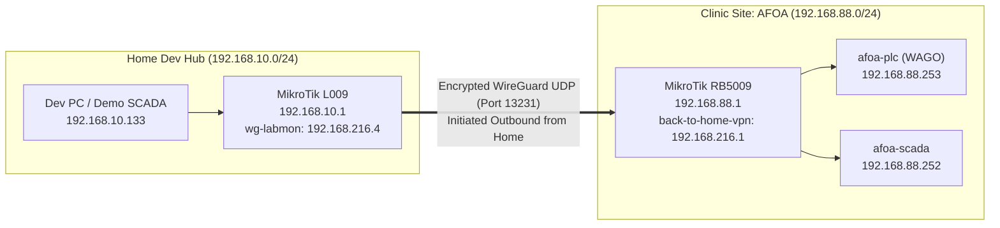

# MikroTik RouterOS v7: Site-to-Site WireGuard Bridging & Multi-Site Selector Guide

> [!NOTE]
> **Topology Context:**
> * **Home Development Hub:** MikroTik L009UiGS-2HaxD (`192.168.10.0/24`) — **Initiator** (Dial-Out Client).
> * **Clinic Remote Sites (Passive Listeners):** MikroTik RB5009 (`192.168.88.0/24`, `192.168.89.0/24`, etc.) — **Listener** (Passive Cloud Endpoint).

---

## 1. What We Did: Active Bridging Configuration

The two routers communicate over an encrypted point-to-point WireGuard tunnel. Traffic between `192.168.10.0/24` (Home) and `192.168.88.0/24` (Clinic) is routed transparently with zero NAT.



### Configuration Applied on Home L009 (`192.168.10.1`)
1. **Interface:** Added `wg-labmon` (Listen Port `13231`).
2. **Address:** `192.168.216.4/24` assigned to `wg-labmon`.
3. **Peer:**
   * **Public Key:** RB5009 Public Key.
   * **Endpoint:** Clinic WAN IP / Cloud DDNS (`*.sn.mynetname.net`).
   * **Endpoint Port:** `13231` (or clinic listen port).
   * **Allowed Address:** `192.168.88.0/24, 192.168.216.0/24`.
   * **Persistent Keepalive:** `25s` *(Keeps the outbound NAT state open indefinitely)*.
4. **Static Route:**
   * `dst-address=192.168.88.0/24 gateway=wg-labmon`.

### Configuration Applied on Clinic RB5009 (`192.168.88.1`)
1. **Peer (in existing `back-to-home-vpn` interface):**
   * **Public Key:** Home L009 Public Key.
   * **Allowed Address:** `192.168.10.0/24, 192.168.216.4/32`.
   * **Endpoint:** *(BLANK — passive listener)*.
2. **Static Route:**
   * `dst-address=192.168.10.0/24 gateway=back-to-home-vpn` (or `192.168.216.4`).

---

## 2. How to Disconnect / Reconnect the Tunnel

You can easily pause or disconnect the site-to-site link from WinBox on your **Home L009**:

### Method A: One-Click Toggle in WinBox (Recommended)
1. Open WinBox on **Home L009** (`192.168.10.1`).
2. Navigate to **WireGuard** $\rightarrow$ **Peers** tab.
3. Select the peer for the clinic (`wg-labmon`).
4. Click the blue **`X`** (Disable) button at the top.
   * *The tunnel immediately drops all traffic. Home devices can no longer reach `192.168.88.x`.*
5. To re-enable, select the peer and click the blue **`✓`** (Enable) button. Handshake re-establishes within seconds.

*(CLI equivalent on Home L009)*:
```routeros
# Disable
/interface/wireguard/peers/disable [find interface=wg-labmon]

# Enable
/interface/wireguard/peers/enable [find interface=wg-labmon]
```

---

## 3. Connecting to a Different Clinic Router (Multi-Site Selector)

As you expand to multiple clinical customers (AFOA, Clinic B, Clinic C), you have two operational models:

### Model 1: Unique Subnets Per Clinic (Simultaneous Full-Mesh Hub)
> [!TIP]
> **Best Practice Recommendation:** Assign a unique `/24` subnet to each clinic:
> * Clinic A (AFOA): `192.168.88.0/24`
> * Clinic B: `192.168.89.0/24`
> * Clinic C: `192.168.90.0/24`

In this model, **you never have to disconnect anything**. Your home router can have simultaneous peers to all clinics at once:
* Any traffic sent to `192.168.88.x` routes to Clinic A.
* Any traffic sent to `192.168.89.x` routes to Clinic B.
* Any traffic sent to `192.168.90.x` routes to Clinic C.

---

### Model 2: Switching Between Sites Sharing the Same Subnet (`192.168.88.0/24`)
If multiple clinics use the same standard factory subnet (`192.168.88.0/24`), only **one** can be actively routed from your home router at a time to prevent an IP route conflict.

#### Step 1: Create Dedicated Peer Profiles on Home L009
In **WireGuard** $\rightarrow$ **Peers**, create a peer entry for each site:
* Peer 1 (Comment: `AFOA - Anchorage`):
  * Public Key: `AFOA_PUBLIC_KEY`
  * Endpoint: `afoa.sn.mynetname.net:13231`
  * Allowed Address: `192.168.88.0/24, 192.168.216.0/24`
* Peer 2 (Comment: `Clinic B - Fairbanks`):
  * Public Key: `CLINIC_B_PUBLIC_KEY`
  * Endpoint: `clinicb.sn.mynetname.net:13231`
  * Allowed Address: `192.168.88.0/24, 192.168.217.0/24`

#### Step 2: The Site Switcher Workflow (WinBox)
To switch connection from AFOA to Clinic B:
1. Open **WireGuard** $\rightarrow$ **Peers**.
2. Select `AFOA` $\rightarrow$ Click **Disable (`X`)**.
3. Select `Clinic B` $\rightarrow$ Click **Enable (`✓`)**.
4. That's it! In less than 5 seconds, your home workstation and bench devices are communicating with Clinic B's hardware at `192.168.88.x`.

---

## 4. Checklist for Adding a Brand New Clinic Site

When preparing a new customer clinic router (e.g. RB5009 for Clinic B):

1. **On the New Clinic Router:**
   * Enable DDNS: `/ip cloud set ddns-enabled=yes`. Note the `DNS Name`.
   * Create WireGuard interface: Listen port `13231`. Note the `Public Key`.
   * Assign transit IP: e.g. `192.168.217.1/24`.
   * Add Home Peer:
     * Public Key: `HOME_L009_PUBLIC_KEY`
     * Allowed Address: `192.168.10.0/24, 192.168.217.4/32`
     * Endpoint: *(Leave blank)*
   * Add Route: `dst-address=192.168.10.0/24 gateway=<wg-interface>`.
   * Firewall: Ensure UDP `13231` is allowed on WAN input, and forward chain allows WG to bridge.

2. **On Home L009:**
   * Add New Peer pointing to Clinic B's DDNS endpoint.
   * Add transit IP if using a new interface, or reuse transit subnet.
   * Ensure route to clinic's LAN exists.
