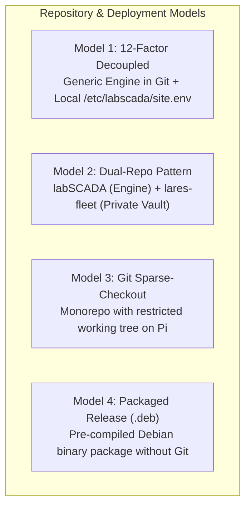

# Multi-Client Isolation & Appliance Deployment Architecture

**Product:** Lares Telemetry  
**Author:** Bob Ostrom / Antigravity Pair Programming  
**Date:** October 2026  
**Status:** Architecture Decision Record (ADR) / Future Roadmap  

---

## 1. Problem Statement & Threat Model

In the initial development and bench-testing phase of Lares Telemetry, site manifests (`sites/demo/` and `sites/afoa/`) reside in the same repository (`labSCADA`). This enabled rapid prototyping, synchronized testing, and seamless continuous integration across multiple test hosts (`demo-scada` and `afoa-scada`).

However, as Lares Telemetry transitions to commercial multi-client deployments:
- **Physical Custody:** SCADA host appliances (Raspberry Pi 4 / CM4) physically reside on customer premises (e.g., inside IVF lab equipment racks, cleanrooms, or IT closets).
- **Cross-Contamination Risk:** If a customer appliance simply clones the primary GitHub repository, that customer's filesystem or Git history would contain:
  - Other clinics' facility names and domain endpoints (`komdivflab.larestelemetry.com`, `clientb.larestelemetry.com`).
  - Third-party API credentials (Pushover App tokens, group keys, webhook URLs).
  - Internal IP addresses, controller topologies, and hardware configurations of rival medical facilities.
- **Regulatory / Privacy Standard:** Medical device telemetries, CAP/CLIA audit trails, and HIPAA-adjacent clinical infrastructure require zero cross-client information leakage.

---

## 2. Evaluated Architectural Approaches



### Approach 1: 12-Factor Decoupled Appliance (Recommended Initial Baseline)
* **Principle:** "Store config in the environment, not in version control."
* **Mechanism:**
  - The `labSCADA` repository contains **zero client-specific secrets, domains, or credentials**.
  - All clinic variables are read strictly from `/etc/labscada/site.env`.
  - The repository maintains only `sites/site.env.example` as a documented template.
  - `.gitignore` explicitly blocks `sites/*/*.env` and any local credential files.
* **Onboarding Workflow:**
  1. Clone generic `labSCADA` on customer Pi.
  2. The commissioning engineer provisions `/etc/labscada/site.env` via USB key, secure one-time script, or local prompt.
  3. The appliance only ever knows its own identity.
* **Pros:** Minimal operational complexity; adheres to standard Linux server conventions; zero extra repositories needed.
* **Cons:** Provisioning step requires manual entry or an installer wizard.

---

### Approach 2: Dual-Repository Pattern (Code vs. Fleet Fleet Vault)
* **Principle:** Complete separation of open/generic platform code from proprietary commercial fleet data.
* **Structure:**
  - **Repository 1 (`labSCADA`):** The software platform (Alert Engine, Kiosk templates, Rapid SCADA drivers, SQL schemas, compliance generators). Can even be public or shared with contractors.
  - **Repository 2 (`lares-fleet`):** Private repository residing **only on the creator's development workstation**. Contains:
    - Client contracts, serial numbers, MAC addresses, and Cloudflare tunnel credentials.
    - Site manifests (`afoa.env`, `client_b.env`).
    - Provisioning playbooks (Ansible or SSH deployment scripts).
* **Onboarding Workflow:**
  1. Customer Pi clones `labSCADA`.
  2. Developer runs `deploy_appliance.sh --client client_b --target 192.168.1.50` from laptop.
  3. Script SCPs *only* `client_b.env` directly into `/etc/labscada/site.env` on that specific appliance.
* **Pros:** Customer Pi has no access to the fleet repository; developer maintains centralized inventory of all deployed hardware.
* **Cons:** Requires running deployment commands from developer laptop.

---

### Approach 3: Git Sparse-Checkout (Monorepo Subset)
* **Principle:** Use Git's native tree-filtering to prevent non-applicable directories from being checked out to disk.
* **Mechanism:**
  ```bash
  git clone --filter=blob:none --no-checkout https://github.com/bobostrom/labSCADA.git
  cd labSCADA
  git sparse-checkout set --cone
  git sparse-checkout set templates scripts assets daemons nginx sites/afoa
  git checkout main
  ```
* **Pros:** Single repository; simple shell command during appliance setup.
* **Cons:** Advanced users inspecting `.git/` objects could still reconstruct other branches/commits unless filtered with Git blobless/treeless clones.

---

### Approach 4: Packaged Binary Release (`.deb` / Debian Package)
* **Principle:** Production appliances run compiled releases, not development source repositories.
* **Mechanism:**
  - GitHub Actions automatically compiles and packages each tagged version (e.g. `v1.2.0`) into:
    `labscada_1.2.0_arm64.deb`
  - On the customer appliance:
    ```bash
    sudo dpkg -i labscada_1.2.0_arm64.deb
    ```
  - Installs files directly to `/opt/labscada/`, registers systemd units, and sets up `/etc/labscada/`.
  - No Git binary, no `.git` directory, and no source code repository exists on the customer machine.
* **Pros:** Maximum security, enterprise-grade, clean updates via `apt-get upgrade labscada`, zero source exposure.
* **Cons:** Requires setting up a CI/CD build pipeline (`dpkg-deb` / GitHub Releases).

---

## 3. Comparison Matrix

| Criteria | Approach 1: 12-Factor | Approach 2: Dual-Repo Vault | Approach 3: Sparse-Checkout | Approach 4: `.deb` Package |
| :--- | :--- | :--- | :--- | :--- |
| **Security & Isolation** | High | Maximum | Moderate | Maximum |
| **Implementation Effort** | Low (Immediate) | Low | Very Low | Moderate |
| **Git Hygiene** | Clean | Clean | Monorepo Bloat | Best (No Git on host) |
| **Maintenance Overhead** | Minimal | Low | Low | Moderate (CI/CD) |
| **Recommended Timing** | Current Phase | Phase 2 (Client #2) | Optional | Phase 3 (Commercial Scale) |

---

## 4. Planned Migration Roadmap

When Lares Telemetry acquires its second independent clinical client:

1. **Step 1 (Repo Scrub):** 
   - Remove active API tokens from Git history.
   - Add `sites/*/*.env` to `.gitignore`.
   - Keep only `sites/site.env.example` as the canonical reference.
2. **Step 2 (Local Vault):**
   - Create private `lares-fleet` repo on Bob's workstation for customer records, IP mappings, and credential manifests.
   - Build a 1-line provisioning tool: `provision_site.sh <client_slug> <target_ip>`.
3. **Step 3 (Packaging):**
   - Package `ivf_alert_engine.py` and templates into a versioned release deb for push-button customer deployments.
